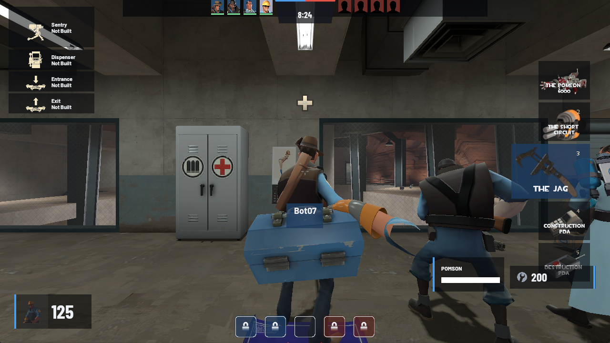
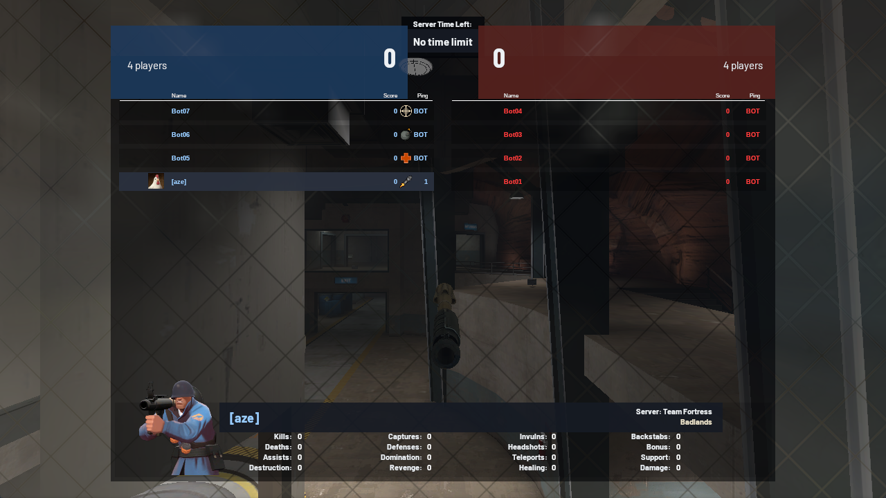
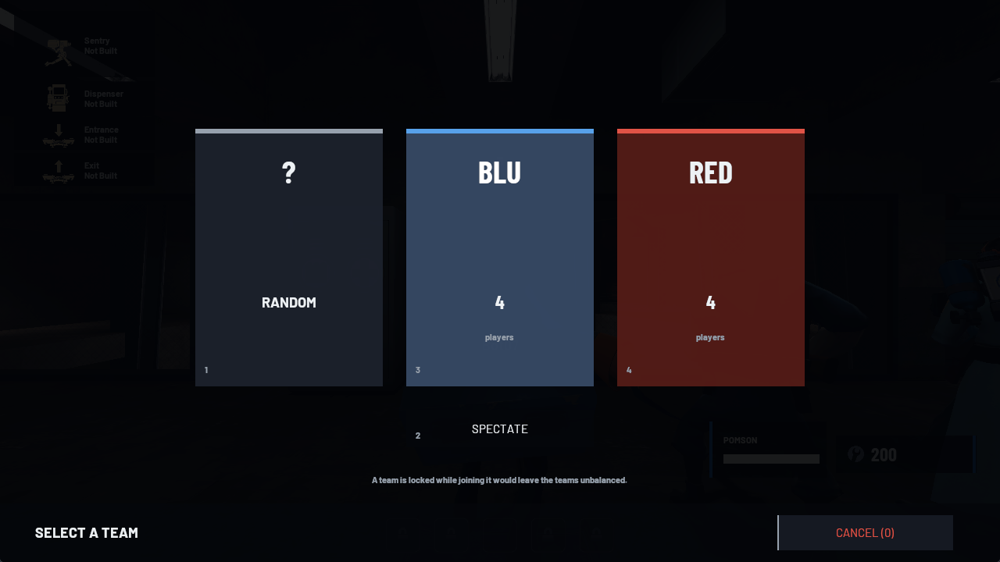
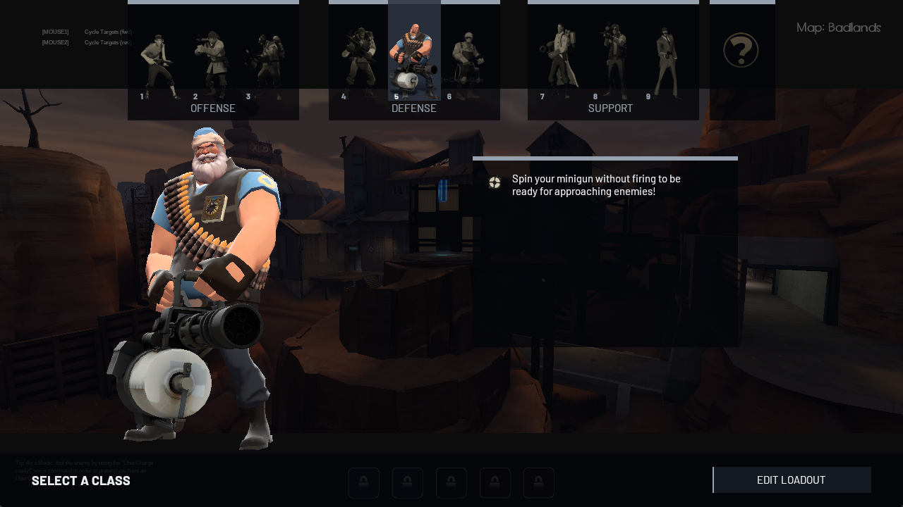
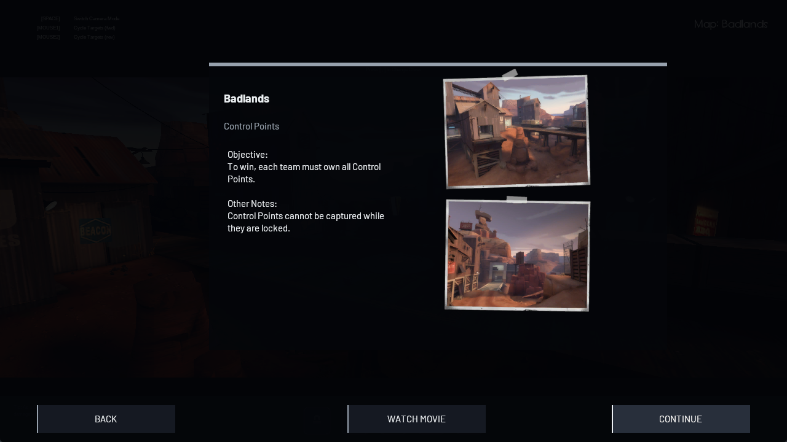
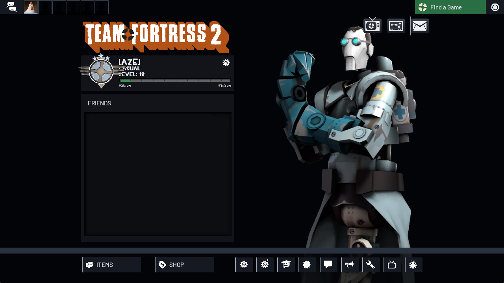
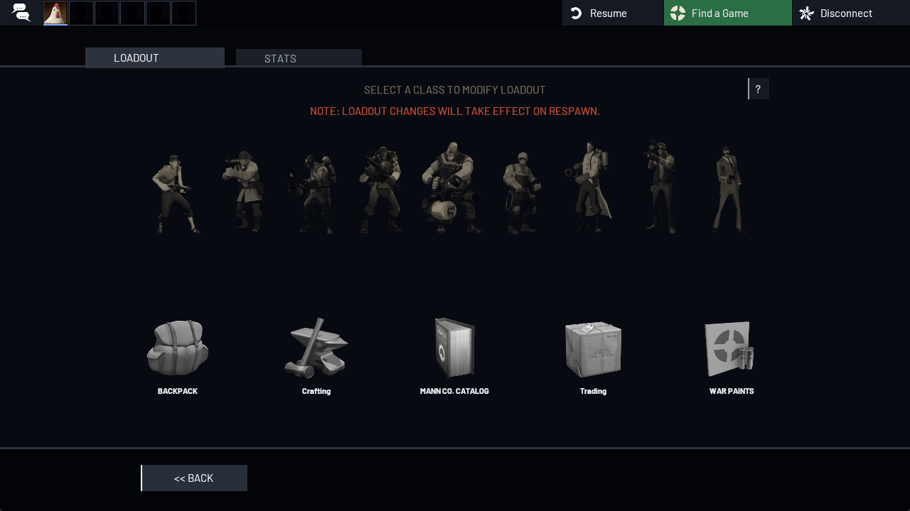
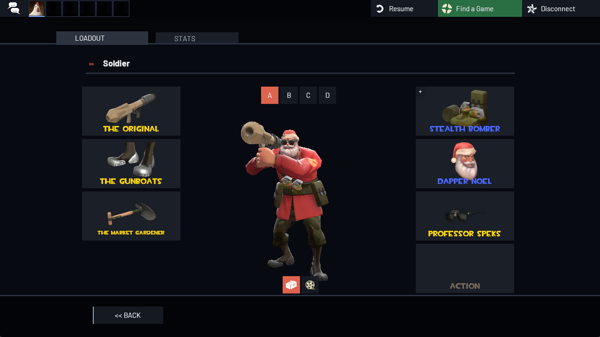
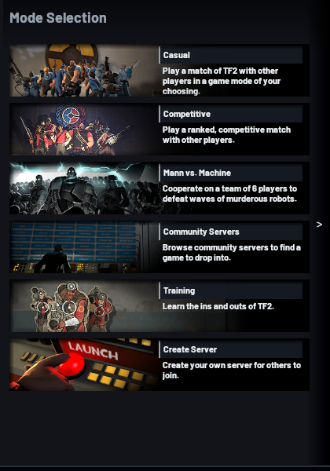
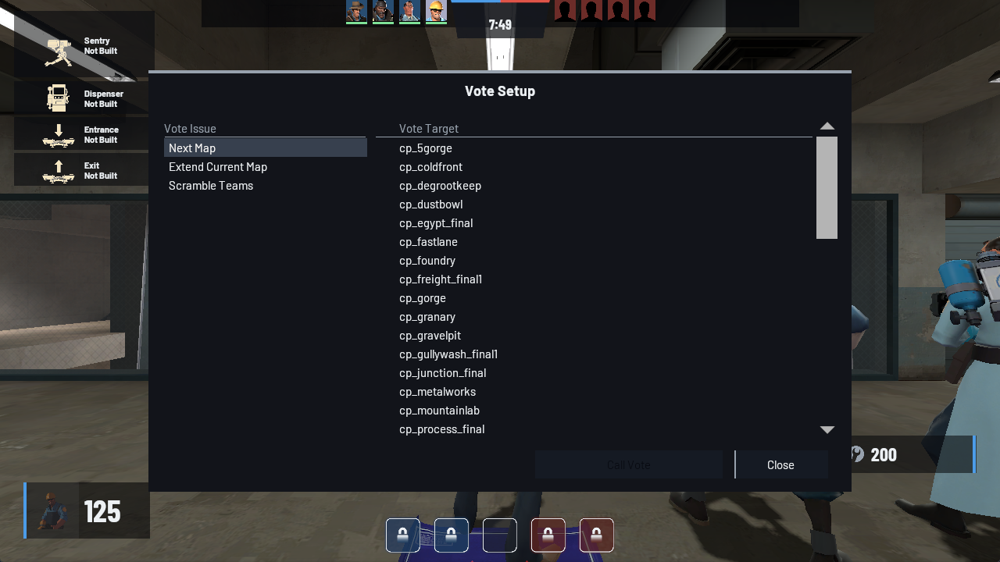

# Meridian - a (work in progress) clean hud for tf2 

Meridian is a flat low‑clutter HUD for Team Fortress 2. Meridian is arranged for 16:10 displays such as 1280×800, 1440×900 1680×1050, 1920×1200 and 2560×1600. Meridian can be installed with a Linux‑friendly script.

Every element of Meridian sits 20 HUD units away from the screen edges. All docks in share one baseline from y = 412 to y = 460 of a 480‑pixel height.

## Install

```sh

./install.sh --autoexec

```

The install script finds TF2 in the places: native Steam, Flatpak, Snap and any other library folders. The script copies the `meridian/` folder into `tf//meridian` and adds `exec meridian` to `tf/cfg/autoexec.cfg`. After that simply restart TF2.

| Option | Effect |

| --- | ---

| `--link` | Create a symlink instead of copying; you can edit Meridian in place and run `hud_reloadscheme` in the console |

| `--tf-dir DIR` / `TF2_DIR=DIR` | Tell the script to use a specific `…/Team Fortress 2/tf` directory |

| `--uninstall` | Remove Meridian and the autoexec line |

You can also install Meridian manually by copying the `meridian/` folder to `~/.steam/steam/steamapps//Team Fortress 2/tf/custom/` and running `exec meridian` once.

### Why `exec meridian`

The file `meridian/cfg/meridian.cfg` sets `cl_hud_playerclass_use_playermodel 0`. With this setting the health dock shows a 2D class icon. If you keep the stock setting (`1`) TF2 draws the 3D model and the icon cell stays empty. Meridian also sets `cl_hud_minmode 0`.

## What is restyled

### In game



The health and ammo docks, item meters, building list, weapon selection and target ID are flat panels with a team-coloured accent edge. The match bar at the top (12v12 portraits, round timer) is in the same style.



### Joining a game

| Team select | Class select |
| --- | --- |
|  |  |



### Menus



| Loadout | Class loadout |
| --- | --- |
|  |  |

| Find a Game | Call Vote |
| --- | --- |
|  |  |

The main menu, pause menu, options dialogs, MOTD and the other chalkboard windows use the same flat buttons and panels.

Fonts are Barlow and Barlow Condensed (SIL OFL, licence in `resource/fonts/ofl.txt`). They are shipped inside the HUD so nothing depends on system fonts. Sizes are set for each 16:10 resolution band so text scales with the layout.

### Left as stock

The remaining HUD files keep the default look: control point icons, win panel, Demoman stickies, MvM, the store, crafting, trading and Mann Co. Catalogue screens (colour pass not checked in-game) and MvM. Add restyled copies to `meridian/resource/ui/` to override any of them.


## Developing

```sh

python3 tools/check.py          # syntax, fonts, materials, VTF headers, lowercase names

python3 tools/gen_textures.py   # rebuild materials/vgui/meridian/*.vtf|vmt (palette lives in the script)

python3 tools/gen_fonts.py      # print the font block used in clientscheme.res

```

The lightly‑modified filesre derived from the stock HUD by scripts so they can be rebuilt when Valve updates the game. Get stock files from [JarateKing/TF2-Hud-Reference](https://github.com/JarateKing/TF2-Hud-Reference) (`reference/` MIT). Extract them from `tf2_misc_dir.vpk` (`python3 tools/vpk_extract.py.../tf/tf2_misc_dir.vpk STOCK 'scripts/*.txt' 'resource/ui/*.res`) then:

```sh

python3 tools/patch_layout.py STOCK/scripts/hudlayout.res        meridian/scripts/hudlayout.res

python3 tools/patch_anims.py  STOCK/scripts/hudanimations_tf.txt meridian/scripts/hudanimations_tf.txt

python3 tools/, patch_ui.py     STOCK/resource/ui                  meridian/resource/ui

python3 tools/gen_meters.py                                      # restyle the class item meters

python3 tools/patch_topbar.py  STOCK/resource/ui                  meridian/resource/ui

python3 tools/patch_menus.py STOCK/resource/ui                    meridian

```

```bash

python3 tools/patch_loadout.py STOCK/resource/ui                  meridian/resource/ui   # also needs econ/*.res extracted

python3 tools/patch_matchmaking.py STOCK/resource/ui              meridian/resource/ui

python3 tools/gen_menu_icons.py.../tf/tf2_textures_dir.vpk       meridian   # recolour the 4 right icon buttons

python3 tools/gen_cp_icons.py.../tf/tf2_textures_dir.vpk         meridian   # recolour the control point icons

python3 tools/patch_hudmisc.py STOCK/resource/ui                   meridian/resource/ui

python3 tools/patch_sourcescheme.py STOCK/resource/sourcescheme.res meridian/resource/sourcescheme.res

python3 tools/patch_classteam.py STOCK/resource/ui                meridian/resource/ui

python3 tools/patch_scoreboard.py STOCK/resource/ui               meridian

python3 tools/patch_buildings.py STOCK                  meridian # building list; needs mod_textures.txt + hud_obj_*.res

```

Every patch has to match exactly once. If it does not the process stops. This means that a change to a stock file will fail loudly of creating a partially patched HUD. The file `clientscheme.res` contains the stock scheme and the Meridian block. Those Meridian markers are visible in the file along with two lines that set the colours of progress bars.

## Known limits

* The Vaccinator resist icon and some status icons use the stock icon art.

* Barlow covers Latin scripts. Player names written in scripts may show missing letters where Meridian displays a name in its own font such, as target ID or the scoreboards name box. The scoreboard player rows keep the stock font for that reason.
